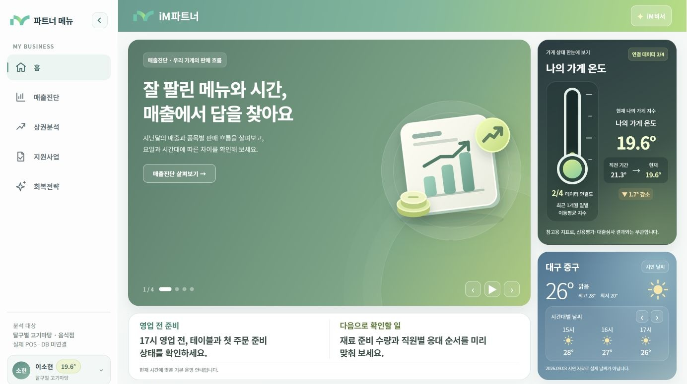

# iM파트너

대구 소상공인 경영·금융 지원 서비스
iM뱅크 2026 AI Blockchain Challenge in Daegu | 4인 팀(iMates) | 팀장

데모: https://im-partner.vercel.app/

## 소개
대구 소상공인이 매출, 유동인구, 금융 상태를 한 화면에서 진단하는 통합 대시보드 프로토타입입니다. 삼성카드 소비 데이터와 소상공인 경기동향 분석으로 문제를 정의했고, 화면은 시연용 데이터로 동작합니다. (2026.09.21 제출 버전)

## 주요 기능
매출진단, 상권분석, 가게 온도, 지원사업 추천, 회복전략 리포트

## 데이터
- 삼성카드 소비 데이터(대구 업종별 월, 요일, 구군 매출)와 소상공인 경기동향을 팀원과 나눠 분석해 제안서 근거로 정리
- 지원사업 공고 22건과 대구 문화축제 공공데이터를 화면에 반영 (실시간 연동 아님)

## 기술
HTML, CSS, JavaScript, Node.js, Vercel

## 내 역할 (고근호, 팀장)
- 역할과 일정 조율, 제안서 작성 총괄
- 디자인부터 화면 개발, 데이터 연동, Vercel 배포까지 직접 진행 (AI 코딩 도구 Codex 활용)

## 문서
- 기획·설계 문서: 저장소의 01~17번 문서 (PRD, 기능 명세, 화면 명세, 테스트 계획 등)
- 개발 기록: [CHANGELOG](docs/CHANGELOG.md)
